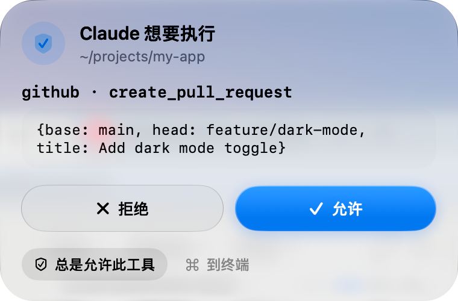
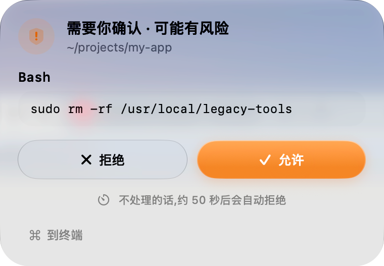

# Claude Notch

> 在屏幕顶部审批 Claude Code 的操作，不用切回终端。
> Approve Claude Code tool calls from a floating Liquid Glass card at the top of your Mac screen.

<p>
  
  
</p>

个人业余作品，按原样提供，不保证维护。中文界面。

## 它做什么

- Claude Code 要执行工具时，屏幕顶部弹出一张卡片：**拒绝 / 允许 / 总是允许此工具 / 到终端**。
- **风险命令单独对待**：`sudo`、`rm -rf`、强制推送 `git push --force`、`git reset --hard`、`dd`、`mkfs`、`diskutil`、下载非本机地址的 `curl`/`wget` 等：
  - 即使你设过"总是允许"，也一定弹卡片；
  - 卡片是橙色的，不能"总是允许"；
  - 约 50 秒没人处理就**自动拒绝**，只拦下这一条命令，并告诉 Claude 原因，会话不会被停掉。
- 普通命令没人处理，约 50 秒后自动放行，避免你离开电脑时工作卡住。
- Plan 模式的计划、`AskUserQuestion` 的选项也能在卡片里直接处理。

## 环境要求

- Apple Silicon Mac，macOS 27
- 完整 Xcode（用来编译 SwiftUI；只有命令行工具不够）
- Claude Code CLI

## 安装

```bash
git clone https://github.com/zeeautoclaw/claude-notch.git
cd claude-notch
./Scripts/build.sh          # 编译
./Scripts/package-app.sh    # 打包成 .app（本机自签名）
mv "build/Claude Notch.app" /Applications/
open "/Applications/Claude Notch.app"
```

请用 `Scripts/build.sh` 编译；`swift build` 目前不支持（源码按单模块方式组织）。

没有苹果开发者签名。第一次打开如果被拦，在 Finder 里右键 → 打开，同意一次即可。

然后点菜单栏图标 → **安装 Hook**。它会：

- 备份 `~/.claude/settings.json` 到 `~/.claude/settings.json.claude-notch.bak`
- 只添加自己的 4 条 hook（PreToolUse / Notification / Stop / UserPromptSubmit），其他配置不动

装好后重启正在运行的 `claude` 会话，新 hook 才会生效。

### 开机自动启动（可选）

```bash
cat > ~/Library/LaunchAgents/local.claudenotch.plist <<'EOF'
<?xml version="1.0" encoding="UTF-8"?>
<!DOCTYPE plist PUBLIC "-//Apple//DTD PLIST 1.0//EN" "http://www.apple.com/DTDs/PropertyList-1.0.dtd">
<plist version="1.0"><dict>
  <key>Label</key><string>local.claudenotch</string>
  <key>ProgramArguments</key><array>
    <string>/usr/bin/open</string><string>-a</string><string>/Applications/Claude Notch.app</string>
  </array>
  <key>RunAtLoad</key><true/>
</dict></plist>
EOF
launchctl bootstrap gui/$(id -u) ~/Library/LaunchAgents/local.claudenotch.plist
```

## 工作原理

```
Claude Code 触发 hook
  → ~/.claude/settings.json 里的命令启动 ClaudeNotchRelay
  → Relay 通过 Unix socket 把事件发给 ClaudeNotchApp
  → App 判断：命中"总是允许"且不是风险命令 → 直接放行；否则弹卡片
  → 你点按钮（或超时）→ 结果原路返回给 Claude Code
```

**设计上偏向"不卡住工作"**：App 没在运行、socket 出错、Relay 等待超过 60 秒时，Relay 会直接放行，这时由 Claude Code 自己的权限设置把关。

## "总是允许"规则

存在 `~/Library/Application Support/ClaudeNotch/rules.json`，可以直接编辑。风险命令不受这些规则影响。

## 跳回终端

| 终端 | 支持 |
|---|---|
| iTerm2 | 跳到对应会话（匹配 `ITERM_SESSION_ID`） |
| Terminal.app | 只能把窗口带到前面 |

需要 macOS 的"自动化"权限：系统设置 → 隐私与安全性 → 自动化。

## 测试

```bash
# 单元测试
xcrun swiftc -O -target arm64-apple-macos27.0 -o build/TestRunner \
    Sources/ClaudeNotchShared/*.swift Tests/Runner/main.swift
./build/TestRunner

# 端到端冒烟（不需要真的 Claude）
./Scripts/smoke.sh
```

## 故障排查

| 现象 | 处理 |
|---|---|
| 不弹卡片 | 菜单栏看是否"已注入"；重启 `claude` 会话；看日志 `~/Library/Logs/ClaudeNotch/app.log` |
| "到终端"没反应 | 检查"自动化"权限 |
| 打开时提示"已损坏" | `xattr -dr com.apple.quarantine "/Applications/Claude Notch.app"` |
| 改了代码要重新部署 | `./Scripts/redeploy.sh` |

## 卸载

```bash
"/Applications/Claude Notch.app/Contents/MacOS/ClaudeNotchApp" --uninstall-hooks
rm -rf "/Applications/Claude Notch.app"
rm -rf ~/Library/Application\ Support/ClaudeNotch ~/Library/Logs/ClaudeNotch
```

## 类似的项目

这个方向已经有不少成熟的开源工具，功能更多、支持更多 AI 编程工具，可以对比着选：
[Casement](https://github.com/aviralgarg05/casement)、
[Coucou](https://github.com/Louis-CFM/coucou)、
[Vibe Notch](https://github.com/farouqaldori/vibe-notch)、
[notch-for-claude-code](https://github.com/deDavil/notch-for-claude-code)。

## License

MIT，见 [LICENSE](LICENSE)。与 Anthropic 无关。
